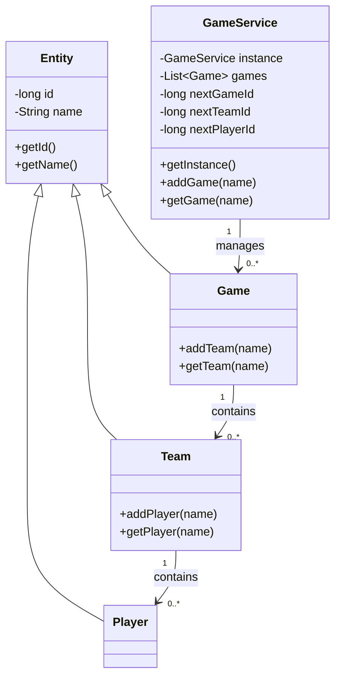
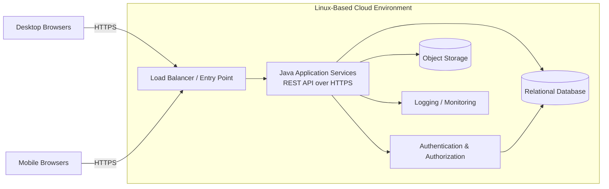

# Draw It or Lose It — Architecture Overview

This page condenses the core software-design decisions from the full CS 230 portfolio artifact into a recruiter-friendly technical view.

> **Scope:** This is an academic software-design and platform-analysis project. The diagrams below represent the recommended architecture and object model; they are not claims of a production deployment.

## Problem

The Gaming Room wanted to evolve **Draw It or Lose It** from an Android-only game into a system that could support users across desktop and mobile platforms while keeping game, team, and player data consistent.

The design therefore needed to address two levels of the problem:

1. **Application structure** — organize games, teams, players, identifiers, and duplicate-name rules.
2. **Platform architecture** — recommend a scalable way to deliver the application across multiple operating systems.

## Object-Oriented Domain Model

The prototype design centralizes game creation and lookup in `GameService`, uses a shared `Entity` base class, and models the containment relationship from games to teams to players.

### Design Patterns and Principles

- **Singleton:** `GameService` provides one in-memory service instance for centralized game management and identifier generation.
- **Inheritance:** `Game`, `Team`, and `Player` inherit common ID and name behavior from `Entity`.
- **Encapsulation:** object state is protected behind class methods rather than exposed directly.
- **Duplicate prevention:** existing collections are searched before new game or team objects are created.
- **Separation of concerns:** domain objects remain separate from future persistence, network, and user-interface layers.

## Recommended Deployment Architecture

The platform recommendation separates the client experience from the backend so that one shared server-side system can support Windows, macOS, Android, iOS, and modern browsers.

## Platform Decision

| Platform | Recommended role | Reasoning |
|---|---|---|
| Linux | Primary backend/server platform | Strong fit for Java services, cloud hosting, automation, containers, and scalable deployment |
| Windows | Viable alternative server environment | Strong enterprise tooling, but less attractive for this recommendation where Microsoft infrastructure is not a requirement |
| macOS | Development and Apple-platform testing | Useful for Safari/iOS validation rather than production hosting |
| Android / iOS | Client platforms | Should consume the shared backend instead of hosting game services |
| Responsive web | Primary client-delivery approach | Gives the broadest cross-platform reach with one shared client strategy |

## Data, Memory, and Reliability

### Storage

- Relational storage for accounts, sessions, teams, scores, and game history.
- Cloud object storage for drawings, images, logs, backups, and other unstructured files.
- Automated backups and replication to reduce data-loss risk.

### Memory

- Linux virtual memory and process isolation support stable server operation.
- The JVM manages application memory through the heap, stack, and garbage collection.
- Runtime monitoring should track memory use, active users, sessions, requests, and database connections.

### Reliability

- Load balancing for traffic distribution.
- Redundant application and data services where appropriate.
- Health monitoring and alerting.
- Tested backup and restore procedures.
- Failover planning for critical components.

## Security Model

The recommended design uses layered controls rather than treating security as a single feature:

- HTTPS/TLS for client-server traffic.
- Strong authentication and role-based authorization.
- Salted password hashing rather than plaintext credential storage.
- Input validation and protected API endpoints.
- Least-privilege access for users, services, files, databases, ports, and cloud resources.
- Encryption of sensitive data at rest.
- Audit logging, monitoring, patching, and vulnerability response.

## Skills Demonstrated

- Java and object-oriented design
- UML/domain modeling
- Design patterns
- Operating-platform evaluation
- Client-server architecture
- RESTful architecture planning
- Linux and cloud fundamentals
- Storage and memory analysis
- Distributed-systems reasoning
- Security and reliability planning
- Technical communication

## Full Portfolio Artifact

The repository's PDF preserves the complete portfolio edition, including the original project analysis, platform comparison, architecture recommendation, and professional reflection.
