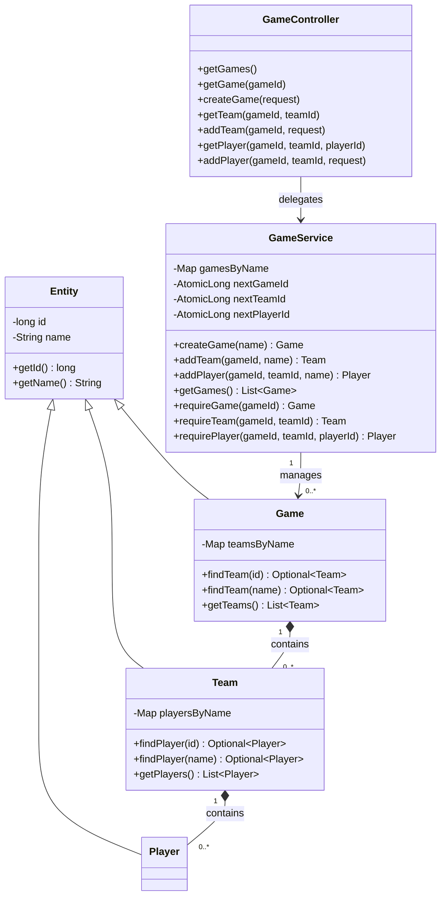
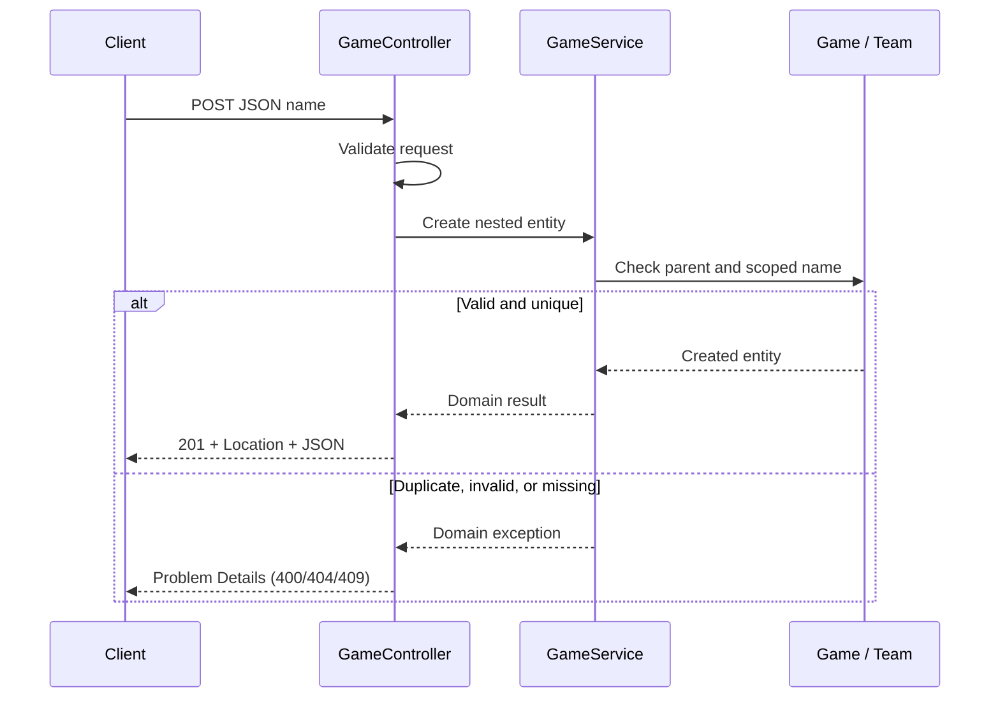
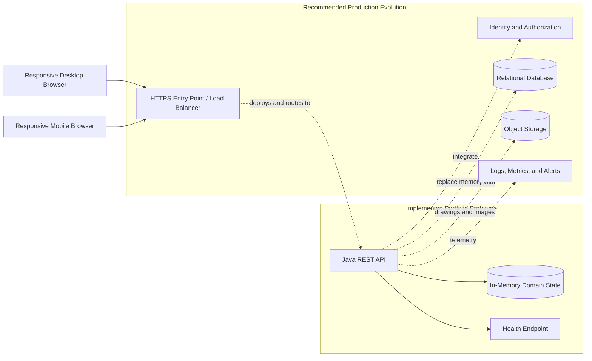

# Draw It or Lose It — Architecture Overview

This page connects the working portfolio prototype to the broader architecture recommended in the original CS 230 analysis.

> **Implementation boundary:** the Java API, in-memory domain model, validation, tests, CI, health check, and container definition are implemented here. Identity, persistence, media storage, the browser client, and cloud infrastructure are recommendations, not claims of a production deployment.

## Problem

The Gaming Room wanted to evolve **Draw It or Lose It** from an Android-only game into a system that could support users across desktop and mobile platforms while keeping game, team, and player data consistent.

The solution has two levels:

1. **Implemented application structure** — games contain teams, teams contain players, identifiers are generated centrally, and names are validated and de-duplicated.
2. **Recommended platform architecture** — a secure, scalable delivery model for several operating systems and devices.

## Implemented Domain and API

`GameService` is a Spring-managed application service. It coordinates globally unique IDs and game creation. Each aggregate protects its own nested collection and uniqueness rule.

### Implemented Design Choices

- **Managed singleton lifecycle:** Spring creates one `GameService` bean for the application. This preserves centralized coordination without static global state.
- **Inheritance:** `Game`, `Team`, and `Player` share immutable ID and name behavior through `Entity`.
- **Composition:** games own teams and teams own players.
- **Scoped duplicate prevention:** normalized map keys make comparisons case-insensitive while retaining the user's display capitalization.
- **Encapsulation:** callers receive immutable list snapshots and cannot mutate internal collections.
- **Concurrency boundary:** creation and lookup operations are synchronized at the service or aggregate that owns the data.
- **Transport separation:** immutable response records prevent the REST interface from exposing domain internals directly.

## Request Flow

## Recommended Production Architecture

The original platform recommendation separates clients from shared backend services. The checked-in prototype represents the API box; the other components show a responsible path to production rather than completed features.

## Platform Decision

| Platform | Recommended role | Reasoning |
|---|---|---|
| Linux | Primary backend/server platform | Strong fit for Java services, cloud hosting, automation, containers, and scalable deployment |
| Windows | Viable alternative server environment | Strong enterprise tooling, but less attractive where Microsoft infrastructure is not a requirement |
| macOS | Development and Apple-platform testing | Useful for Safari and iOS validation rather than general production hosting |
| Android / iOS | Client platforms | Consume the shared service instead of hosting game logic |
| Responsive web | Primary client-delivery approach | Broad cross-platform reach with one shared client strategy |

## Production Evolution

The prototype deliberately starts small. A responsible next phase would:

1. Replace in-memory maps and counters with relational persistence and database constraints.
2. Add authentication and role-based authorization before exposing player or administrative actions.
3. Add game-session, round, timer, drawing, and scoring behavior from explicit product requirements.
4. Store drawings in object storage and keep only metadata and ownership links in the relational database.
5. Add structured logs, metrics, traces, alerts, rate limits, and security headers.
6. Deploy redundant stateless API instances behind HTTPS and verify backup and restore procedures.

## Security and Reliability Model

The production recommendation uses layered controls:

- HTTPS/TLS for client-server traffic.
- Strong authentication and role-based authorization.
- Salted password hashing through a proven identity system, never plaintext credential storage.
- Input validation, database constraints, and protected endpoints.
- Least-privilege access for users, services, files, databases, ports, and cloud resources.
- Encryption for sensitive data and backups.
- Audit logging, dependency updates, monitoring, patching, and vulnerability response.
- Load balancing, redundant services, health checks, tested backups, and failover planning.

## Verification Assets

- [`GameServiceTest`](../src/test/java/tech/ksobers/drawit/domain/GameServiceTest.java) verifies the domain hierarchy, uniqueness scopes, IDs, validation, and immutable snapshots.
- [`GameApiIntegrationTest`](../src/test/java/tech/ksobers/drawit/api/GameApiIntegrationTest.java) starts the service on a real port and exercises successful and failed HTTP journeys plus health.
- [OpenAPI contract](openapi.yaml) documents the implemented interface.
- [GitHub Actions workflow](../.github/workflows/ci.yml) runs the Maven verification lifecycle on every pull request.

## Full Portfolio Artifact

The repository's [original PDF](../Draw_It_or_Lose_It_Portfolio_Keishmar_Sobers_UNIVERSAL.pdf) preserves the complete course analysis, platform comparison, recommendation, and reflection unchanged.
